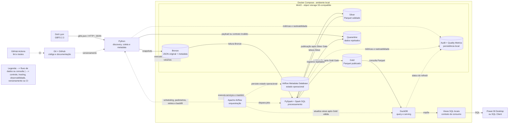

# Dott Lyon Medallion Data Pipeline

> Pipeline de Engenharia de Dados para ingestão, processamento, organização e disponibilização dos dados GBFS de bicicletas e patinetes Dott na Métropole de Lyon, utilizando arquitetura Medalhão e uma stack local, gratuita, reproduzível e orientada a estudo e portfólio.

## Status do projeto

[github.com/Gusta101/lyon-mobility-pipeline](https://github.com/Gusta101/lyon-mobility-pipeline)


> O projeto está em planejamento. Comandos, produtos Gold e componentes descritos como planejados não devem ser interpretados como já implementados. Decisões ainda não definidas estão identificadas como **Not defined / TBD**.

## Sumário

- [1. Visão geral](#1-visão-geral)
- [2. Problema e motivação](#2-problema-e-motivação)
- [3. Fonte de dados](#3-fonte-de-dados)
- [4. Objetivos](#4-objetivos)
- [5. Estado final desejado](#5-estado-final-desejado)
- [6. Arquitetura proposta](#6-arquitetura-proposta)
- [7. Arquitetura Medalhão](#7-arquitetura-medalhão)
- [8. Stack tecnológica e decisões](#8-stack-tecnológica-e-decisões)
- [9. Estrutura do repositório](#9-estrutura-do-repositório)
- [10. Organização dos dados](#10-organização-dos-dados)
- [11. Fluxo da pipeline](#11-fluxo-da-pipeline)
- [12. Qualidade, auditoria e observabilidade](#12-qualidade-auditoria-e-observabilidade)
- [13. Segurança e configuração](#13-segurança-e-configuração)
- [14. Estratégia de testes](#14-estratégia-de-testes)
- [15. Execução local planejada](#15-execução-local-planejada)
- [16. Operação, idempotência e reprocessamento](#16-operação-idempotência-e-reprocessamento)
- [17. Roadmap local](#17-roadmap-local)
- [18. Critérios de sucesso](#18-critérios-de-sucesso)
- [19. Limitações conhecidas](#19-limitações-conhecidas)
- [20. Licença e uso dos dados](#20-licença-e-uso-dos-dados)
- [21. Autor](#21-autor)

## 1. Visão geral

Este projeto tem como objetivo construir uma pipeline de dados ponta a ponta usando dados de mobilidade compartilhada da Dott em Lyon. A solução deverá coletar snapshots do feed GBFS, preservar os dados recebidos, tratá-los, aplicar regras de qualidade, produzir conjuntos analíticos e disponibilizar uma camada de consumo por SQL.

A implementação será integralmente local e gratuita. O Data Lake será simulado com MinIO, os serviços serão executados em containers Docker e o Apache Airflow será responsável pela orquestração em Docker Compose. O DuckDB fornecerá a camada SQL local e as views estáveis de consumo sobre os arquivos Parquet publicados na Gold.

O projeto é intencionalmente orientado à documentação. Decisões arquiteturais, contratos de dados, regras de qualidade, mudanças de schema e procedimentos operacionais serão versionados junto ao código.

## 2. Problema e motivação

Feeds de mobilidade em tempo real representam o estado de um sistema em determinado instante. Consultar somente o estado atual não permite responder perguntas históricas, como:

- Como a disponibilidade de veículos varia por horário e dia da semana?
- Quais áreas concentram mais bicicletas ou patinetes disponíveis?
- Em quais momentos há maior indisponibilidade operacional?
- Como a distribuição espacial dos veículos muda ao longo do tempo?
- Há anomalias, quebras de schema ou períodos sem atualização do feed?

A pipeline será construída para transformar snapshots operacionais em dados históricos, governados e consultáveis. O foco não é apenas gerar um dashboard, mas demonstrar fundamentos de Engenharia de Dados: ingestão idempotente, armazenamento em camadas, transformação com PySpark, qualidade, rastreabilidade, orquestração, testes e infraestrutura reproduzível.

## 3. Fonte de dados

### Dataset escolhido

- **Nome:** Vélos et trottinettes Dott Lyon
- **Publicador:** Dott
- **Cobertura:** Métropole de Lyon, França
- **Formato:** GBFS em JSON
- **Versão informada pelo catálogo:** GBFS 2.3
- **Natureza:** dados em tempo real
- **Catálogo:** [Dott Lyon no transport.data.gouv.fr](https://transport.data.gouv.fr/datasets/tier-dott-gbfs-lyon)
- **Feed de descoberta GBFS:** [gbfs.json da Dott Lyon](https://gbfs.api.ridedott.com/public/v2/lyon/gbfs.json)
- **Termos de uso da API:** [Dott API Licence](https://ridedott.com/api-licence/)

O arquivo `gbfs.json` atua como feed de descoberta e fornece referências para os feeds disponibilizados pelo operador. A pipeline deverá descobrir os endpoints em tempo de execução, em vez de manter URLs internas fixas sempre que isso for possível.

### Estratégia de coleta

A fonte já disponibiliza uma API estruturada. Por isso, a primeira versão utilizará requisições HTTP com Python, e não Selenium. Automação de navegador seria mais lenta, mais frágil e desnecessária para esta origem. Um crawler ou Selenium poderá ser avaliado somente para uma segunda fonte que realmente dependa de navegação em página.

Cada execução deverá armazenar o payload original e metadados técnicos, possibilitando reconstruir o histórico a partir de snapshots sucessivos.

A frequência de coleta, os limites de requisição, os timeouts e a política exata de backoff permanecem **Not defined / TBD** e deverão ser definidos após revisão dos termos vigentes e testes controlados da origem.

### Atenção aos termos de uso

Antes da coleta recorrente ou da redistribuição de dados, devem ser revisados os termos vigentes da Dott. O catálogo informa licença não especificada e direciona o usuário aos termos da API. Este repositório não deverá publicar chaves, credenciais nem cópias redistribuíveis dos dados sem autorização.

## 4. Objetivos

### Objetivo principal

Desenvolver uma pipeline de dados completa, reproduzível e documentada, que transforme feeds GBFS da Dott Lyon em conjuntos históricos e analíticos organizados nas camadas Bronze, Silver e Gold.

### Objetivos técnicos

- Consumir e validar o feed de descoberta GBFS.
- Coletar snapshots dos feeds disponíveis em intervalos controlados.
- Preservar os payloads originais na camada Bronze.
- Padronizar schemas, tipos, timestamps e identificadores na Silver.
- Criar métricas e tabelas analíticas na Gold.
- Armazenar Bronze, Silver, Gold, Quarantine e Audit no MinIO.
- Usar Parquet nas camadas tratadas para leitura analítica eficiente.
- Orquestrar tarefas, dependências, tentativas, agendamentos e backfills com Airflow.
- Permitir reprocessamento por intervalo, feed, entidade e identificador de execução.
- Implementar logging, auditoria e testes de qualidade de dados.
- Disponibilizar views SQL locais com DuckDB.
- Permitir consumo por Power BI Desktop ou cliente SQL gratuito.
- Automatizar verificações de código, documentação e testes com GitHub Actions.
- Executar todo o projeto localmente com Docker Compose e sem dependência obrigatória de serviços pagos.

### Fora do escopo inicial

- Rastreamento de usuários ou viagens individuais.
- Previsão de demanda com Machine Learning.
- Streaming de baixa latência.
- Dashboard complexo antes da estabilização da pipeline.
- Infraestrutura distribuída ou serviços obrigatórios de nuvem.

## 5. Estado final desejado

### Ponto de partida

O projeto começa com:

- uma fonte pública/externa em JSON e padrão GBFS;
- ausência de histórico próprio;
- execução local e manual;
- nenhuma infraestrutura criada;
- foco em ferramentas gratuitas;
- documentação da arquitetura antes da implementação.

### Estado intermediário esperado

A primeira versão deverá possuir:

- MinIO simulando um Data Lake baseado em object storage;
- Bronze, Silver e Gold separadas logicamente;
- scripts Python e jobs PySpark independentes;
- dados Silver e Gold em Parquet;
- Quarantine e Audit persistidos no MinIO;
- DAGs no Airflow;
- banco local de metadados do Airflow;
- ambiente Docker Compose reproduzível;
- consultas SQL locais com DuckDB;
- testes automatizados;
- métricas de execução e qualidade;
- documentação de dados e operação.

### Estado final desejado

A arquitetura definitiva deverá permitir:

- preservar snapshots históricos no MinIO;
- reconstruir Silver e Gold a partir da Bronze;
- publicar produtos Gold somente após validação;
- disponibilizar views estáveis no DuckDB;
- conectar Power BI Desktop ou um cliente SQL às views locais;
- executar Airflow, MinIO, banco de metadados e componentes auxiliares com Docker Compose;
- executar CI pelo GitHub Actions;
- manter rastreabilidade entre fonte, objeto Bronze, transformação Silver, saída Gold e view de consumo;
- realizar backfill, replay e reprocessamento com parâmetros controlados;
- evoluir qualidade, observabilidade, retenção, recuperação e eficiência sem dependência obrigatória de nuvem.

O princípio de evolução será: **primeiro uma pipeline correta e observável; depois maturidade operacional, otimização e automação local**.

## 6. Arquitetura proposta



O fluxo contínuo representa dados ou consultas. O fluxo tracejado representa controle, execução, observabilidade, infraestrutura, versionamento ou CI. Airflow não transporta dados, Docker Compose não processa dados e GitHub Actions não executa a pipeline operacional recorrente.

## 7. Arquitetura Medalhão

### Bronze: dados brutos e históricos

A Bronze preservará cada resposta recebida com o mínimo de alteração possível.

**Responsabilidades:**

- armazenar o JSON original;
- preservar o conteúdo recebido;
- registrar URL, feed, horário de coleta, status HTTP e identificador da execução;
- registrar content type, checksum, tamanho do payload e versão da pipeline;
- permitir auditoria, replay e reprocessamento;
- evitar sobrescrita de snapshots anteriores.

**Não deve fazer:**

- agregações;
- regras de negócio;
- renomeações destrutivas;
- remoção silenciosa de registros;
- correções do conteúdo original.

Payloads recebidos deverão ser preservados quando tecnicamente possível, inclusive quando falharem em validações de conteúdo. A política exata para respostas ilegíveis ou incompletas permanece **Not defined / TBD**.

### Silver: dados limpos e confiáveis

A Silver representará os dados padronizados em nível de entidade.

**Responsabilidades:**

- aplicar schema explícito;
- normalizar nomes de colunas;
- converter epoch para timestamps em UTC;
- registrar horário de ingestão e processamento;
- tratar duplicidades de forma documentada;
- validar campos obrigatórios;
- separar registros inválidos ou rejeitados;
- gravar arquivos Parquet particionados;
- manter granularidade adequada para análises históricas;
- preservar rastreabilidade até o objeto Bronze e o `run_id`.

### Gold: dados orientados ao negócio e consumo

A Gold conterá produtos de dados derivados da Silver.

**Produtos inicialmente candidatos:**

- disponibilidade de veículos por snapshot;
- disponibilidade por tipo de veículo;
- contagem por hora e dia da semana;
- distribuição por área geográfica, quando os campos permitirem;
- indicadores de atualização e qualidade do feed;
- dimensão de tempo;
- dimensão de veículo ou tipo de veículo, quando aplicável;
- fatos de disponibilidade e status operacional.

As tabelas definitivas serão determinadas após o profiling real dos feeds descobertos. DuckDB consumirá os arquivos Gold, mas não substituirá a camada Gold nem será o armazenamento oficial das camadas Medallion.

## 8. Stack tecnológica e decisões

### Python

Será a linguagem principal de integração. Ficará responsável por requisições HTTP, descoberta de feeds, validações iniciais, geração de metadados, interação com MinIO, tarefas auxiliares do Airflow e testes.

**Motivo da escolha:** ampla adoção em Engenharia de Dados, boa integração com APIs, Spark e Airflow, além de permitir reaproveitamento do conhecimento entre diferentes partes da pipeline.

### Requests ou cliente HTTP equivalente

Será utilizado para consumir os endpoints GBFS.

**Motivo da escolha:** a origem disponibiliza JSON via HTTP; portanto, uma chamada direta é mais simples e robusta que automação de navegador.

### PySpark

Será utilizado nas transformações Bronze → Silver e Silver → Gold.

**Motivo da escolha:** aproxima o projeto de cenários de processamento distribuído, oferece DataFrames e integração com Spark SQL e permite exercitar padrões relevantes de Engenharia de Dados.

O volume inicial pode não exigir processamento distribuído. PySpark é mantido por objetivo pedagógico e adiciona consumo de memória, tempo de inicialização, compatibilidade com Java e risco de gerar arquivos pequenos. Os containers e jobs deverão receber limites de recursos compatíveis com a máquina local.

### SQL e Spark SQL

Serão utilizados para regras declarativas, validações, agregações e construção de produtos Gold.

**Motivo da escolha:** SQL é essencial para modelagem, exploração e validação de dados e pode ser usado tanto no Spark SQL quanto na camada de consumo do DuckDB.

### Apache Airflow

Será responsável pela orquestração, e não pela lógica de negócio ou transporte de dados.

**Uso planejado:**

- agendar coletas;
- controlar dependências;
- executar retries com backoff;
- registrar logs operacionais;
- parametrizar intervalos;
- disparar jobs Python e PySpark;
- impedir avanço quando validações críticas falharem;
- permitir backfill e reprocessamento;
- atualizar views locais após publicação Gold válida;
- publicar métricas de auditoria.

Airflow adiciona complexidade operacional e exige banco de metadados, configuração e containers próprios. Seu uso é mantido para demonstrar scheduling, dependências, retries, backfill, parâmetros e observabilidade. O executor, o banco de metadados e o método exato de disparo dos jobs PySpark permanecem **Not defined / TBD**.

### MinIO

Será o armazenamento físico local das camadas Bronze, Silver, Gold, Quarantine e Audit. O MinIO é compatível com a API S3 e permite exercitar buckets, objetos, prefixos, credenciais, políticas de acesso e organização de um Data Lake baseado em object storage.

**Motivo da escolha:** permite estudar conceitos gerais de armazenamento de objetos e Data Lake sem custos obrigatórios de nuvem.

MinIO não deve ser tratado como reprodução integral de recursos específicos de uma plataforma de nuvem. Ele atende ao escopo local do projeto e não é uma solução temporária aguardando migração obrigatória.

### Parquet

Será o formato predominante da Silver e Gold.

**Motivo da escolha:** formato colunar apropriado para análise, compressão e leitura seletiva por engines como Spark e DuckDB.

### DuckDB

Será a engine SQL local responsável por consultar arquivos Parquet publicados na Gold e disponibilizar views SQL estáveis.

**Motivo da escolha:** possui baixa complexidade operacional, consulta Parquet de forma eficiente e separa os arquivos físicos do contrato SQL consumido por ferramentas analíticas.

O método exato de acesso do DuckDB aos objetos no MinIO, a persistência do arquivo de catálogo e a estratégia de atualização das views permanecem **Not defined / TBD**.

### Docker e Docker Compose

Executarão MinIO, Airflow, o banco de metadados e os componentes auxiliares necessários ao ambiente local.

**Motivo da escolha:** tornam o ambiente reproduzível, isolam dependências e reduzem diferenças entre máquinas. Docker Compose é suficiente para um ambiente educacional, local e single-host sem requisito de alta disponibilidade.

### Git e GitHub

Serão usados para versionamento, revisão, rastreamento de mudanças, documentação, issues e gestão do roadmap.

### GitHub Actions

Executará lint, testes unitários, testes de contrato, testes de qualidade, integrações viáveis e validações básicas de documentação em pushes e pull requests. Não será responsável pela execução recorrente da pipeline operacional.

### Power BI Desktop ou cliente SQL

Power BI Desktop poderá ser utilizado como consumidor opcional. O projeto também deverá permitir o uso de um cliente SQL gratuito, evitando que Power BI seja uma dependência obrigatória.

### Selenium

Não será utilizado na primeira versão.

**Motivo:** já existe uma API estruturada. Selenium só será introduzido se uma futura origem depender de interação com navegador e não oferecer alternativa apropriada.

## 9. Estrutura do repositório

```text
dott-lyon-medallion-pipeline/
├── .github/
│   ├── ISSUE_TEMPLATE/
│   └── workflows/
│       └── ci.yml
├── config/
│   ├── dev.example.yml
│   └── logging.yml
├── dags/
│   └── dott_lyon_medallion_dag.py
├── docs/
│   ├── architecture.md
│   ├── data-contracts.md
│   ├── data-dictionary.md
│   ├── operations.md
│   └── roadmap.md
├── infrastructure/
│   ├── airflow/
│   │   └── Dockerfile
│   ├── docker/
│   │   └── docker-compose.yml
│   ├── duckdb/
│   └── minio/
│       └── init-buckets.sh
├── medallion/
│   ├── bronze/
│   │   ├── data/
│   │   │   └── .gitkeep
│   │   ├── jobs/
│   │   │   └── ingest_gbfs.py
│   │   └── README.md
│   ├── silver/
│   │   ├── data/
│   │   │   └── .gitkeep
│   │   ├── jobs/
│   │   │   └── transform_gbfs.py
│   │   └── README.md
│   └── gold/
│       ├── data/
│       │   └── .gitkeep
│       ├── jobs/
│       │   └── build_marts.py
│       ├── sql/
│       │   └── views.sql
│       └── README.md
├── notebooks/
│   └── exploration/
├── src/
│   └── dott_pipeline/
│       ├── clients/
│       ├── common/
│       ├── quality/
│       └── storage/
├── tests/
│   ├── contract/
│   ├── data_quality/
│   ├── integration/
│   └── unit/
├── .env.example
├── .gitignore
├── CHANGELOG.md
├── CONTRIBUTING.md
├── LICENSE
├── Makefile
├── README.md
├── pyproject.toml
└── requirements.txt
```

### Princípios da estrutura

- `medallion/` torna explícitas as responsabilidades de Bronze, Silver e Gold.
- Cada camada possui jobs, documentação e uma referência local de `data/`.
- Os dados reais não serão versionados. As pastas `data/` existirão apenas para amostras pequenas autorizadas ou referência de desenvolvimento e serão protegidas pelo `.gitignore`.
- Os dados oficiais da pipeline residirão no MinIO.
- `src/dott_pipeline/` conterá código reutilizável, evitando duplicação entre jobs.
- `dags/` conterá apenas orquestração e chamadas aos módulos, não transformações extensas.
- `notebooks/` será exclusivo para exploração, nunca a implementação oficial da pipeline.
- `infrastructure/duckdb/` poderá conter scripts de inicialização das views e configuração local, sem armazenar dados Gold.

## 10. Organização dos dados

### Organização lógica no Data Lake

```text
datalake/
├── bronze/
│   └── dott_lyon/
│       └── <feed_name>/
│           └── ingestion_date=YYYY-MM-DD/
│               └── run_id=<id>/
│                   ├── payload.json
│                   └── metadata.json
├── silver/
│   └── dott_lyon/
│       └── <entity>/
│           └── event_date=YYYY-MM-DD/
│               └── part-*.parquet
├── gold/
│   └── dott_lyon/
│       └── <data_product>/
│           └── reference_date=YYYY-MM-DD/
│               └── part-*.parquet
├── quarantine/
│   └── dott_lyon/
│       └── <entity>/
│           └── processing_date=YYYY-MM-DD/
└── audit/
    └── <estrutura Not defined / TBD>
```

Bronze, Silver, Gold, Quarantine e Audit serão persistidos no MinIO. A estrutura exata de Audit, sua granularidade e seus formatos permanecem **Not defined / TBD**. Uma estrutura por pipeline, data de execução e `run_id` poderá ser avaliada, mas ainda não constitui requisito fechado.

### Metadados mínimos de ingestão

- `run_id`
- `source_system`
- `source_url`
- `feed_name`
- `requested_at_utc`
- `received_at_utc`
- `http_status`
- `content_type`
- `checksum`
- `payload_size_bytes`
- `record_count`, quando calculável
- `pipeline_version`

### Particionamento

O particionamento será definido com base em medições, não apenas por convenção. A primeira proposta usa data de ingestão na Bronze e data de referência nas camadas tratadas. Partições e arquivos excessivamente pequenos deverão ser evitados.

### Versionamento de schema

Schemas esperados devem ser documentados em `docs/data-contracts.md`. Mudanças incompatíveis devem:

- falhar uma validação controlada;
- enviar dados à Quarantine quando apropriado;
- gerar log, auditoria e alerta local quando configurado;
- ser documentadas antes da adaptação do pipeline.

### Persistência dos serviços

Volumes Docker deverão preservar, no mínimo:

- objetos do MinIO;
- banco de metadados do Airflow;
- logs necessários para operação;
- arquivo DuckDB, caso seja adotada persistência local do catálogo.

Nomes dos volumes, retenção, backup, limpeza e recuperação permanecem **Not defined / TBD**. A remoção de volumes deverá ser tratada como operação destrutiva.

Datasets candidatos Silver e Gold são estados lógicos da validação. Sua persistência física temporária não está definida e não deve ser presumida.

## 11. Fluxo da pipeline

```text
start
  └── discover_feeds
        └── extract_feed_snapshots
              └── validate_http_responses
                    └── write_bronze
                          └── validate_bronze
                                └── bronze_to_silver
                                      └── validate_silver
                                            └── silver_to_gold
                                                  └── validate_gold
                                                        └── refresh_local_views
                                                              └── publish_audit_metrics
                                                                    └── end
```

O Airflow controla dependências e estados, mas os dados não trafegam através do Airflow. A ingestão Python, os jobs PySpark, o MinIO e o DuckDB compõem o data plane.

A atualização das views deverá ocorrer apenas após a publicação de uma Gold válida. Uma falha crítica não deverá substituir a última versão estável disponível para consumo.

## 12. Qualidade, auditoria e observabilidade

### Bronze Quality Gate

Deverá validar, quando aplicável:

- status HTTP;
- legibilidade do payload;
- content type;
- presença da metadata mínima;
- checksum;
- rastreabilidade por `run_id`;
- compatibilidade inicial com o contrato GBFS.

Falhas críticas deverão impedir o avanço do objeto afetado, gerar auditoria e preservar o payload recebido quando tecnicamente possível. A política exata para payloads ilegíveis permanece **Not defined / TBD**.

### Silver Quality Gate

Deverá validar:

- schema explícito;
- campos obrigatórios;
- tipos;
- unicidade e deduplicação;
- regras temporais;
- regras geográficas, quando aplicáveis;
- reconciliação com a Bronze.

Registros válidos poderão ser publicados. Registros inválidos deverão seguir para Quarantine com motivo, regra violada, `run_id` e referência ao objeto de origem. Limites para bloqueio total ou publicação parcial permanecem **Not defined / TBD**.

### Gold Quality Gate

Deverá validar:

- regras de negócio documentadas;
- consistência das agregações;
- reconciliação de volumes;
- consistência das métricas;
- condição de publicação.

Uma falha crítica deverá impedir a publicação da nova Gold e a atualização das views correspondentes.

### Métricas operacionais

- duração por tarefa;
- status da execução;
- quantidade de tentativas;
- bytes recebidos e gravados;
- tempo desde a última atualização da fonte;
- quantidade de feeds descobertos;
- erros HTTP por endpoint.

### Métricas de dados

- registros lidos, válidos, rejeitados e gravados;
- percentual de nulos em campos obrigatórios;
- duplicidades por chave candidata;
- timestamps fora de faixa;
- coordenadas inválidas, quando existentes;
- diferença de volume entre camadas;
- atraso entre timestamp da fonte e ingestão.

### Auditoria e rastreabilidade

Cada saída deverá ser associada ao `run_id`, à versão do código e aos objetos de origem. Audit e Quality Metrics deverão ser persistidos localmente no MinIO, em formato ainda **Not defined / TBD**.

Quando disponíveis, os registros deverão conter:

- `run_id`;
- versão do código ou pipeline;
- objetos de origem e destino;
- contagens de leitura, escrita e rejeição;
- resultados das regras;
- duração e status;
- feed e entidade;
- versão de schema;
- status da atualização das views.

Essa capacidade representa auditoria e rastreabilidade técnica. O projeto não deve declarar full data lineage sem evidência adicional.

Logs e metadados do Airflow são operacionais e não substituem Audit e Quality Metrics.

## 13. Segurança e configuração

- Credenciais nunca devem ser commitadas.
- `.env` deve permanecer ignorado.
- `.env.example` deve conter apenas nomes e valores fictícios.
- Chaves da API, se exigidas, devem ser tratadas como secrets.
- Logs não devem imprimir tokens ou payloads sensíveis.
- O princípio de menor privilégio será usado para acesso ao MinIO.
- Dados brutos não serão publicados no GitHub sem validação dos termos de uso.
- Configurações reais devem ficar separadas dos arquivos de exemplo versionados.

Variáveis inicialmente previstas:

```dotenv
DOTT_GBFS_DISCOVERY_URL=https://gbfs.api.ridedott.com/public/v2/lyon/gbfs.json
MINIO_ENDPOINT=http://minio:9000
MINIO_ACCESS_KEY=change_me
MINIO_SECRET_KEY=change_me
MINIO_BUCKET=datalake
AIRFLOW_UID=50000
PIPELINE_ENV=dev
```

O endpoint `http://minio:9000` pressupõe comunicação entre containers na rede do Docker Compose. A configuração de acesso pelo host poderá usar endpoint diferente e deverá ser documentada separadamente.

## 14. Estratégia de testes

### Testes unitários

- parsing do feed de descoberta;
- normalização de nomes;
- conversão de timestamps;
- geração de caminhos;
- validações de schema;
- regras de deduplicação;
- cálculo de checksum.

### Testes de integração

- leitura controlada da API e tratamento de respostas;
- escrita e leitura no MinIO;
- leitura Bronze pelo Spark;
- gravação Silver e Gold em Parquet;
- consulta dos arquivos pelo DuckDB;
- execução de uma DAG de teste;
- persistência após reinicialização dos containers.

### Testes de qualidade de dados

- campos obrigatórios não nulos;
- unicidade de chaves candidatas;
- integridade entre entidades;
- validade de latitude e longitude;
- coerência temporal;
- atualização do feed dentro do limite esperado;
- reconciliação de volumes entre camadas.

### Testes de contrato

Uma amostra controlada deverá validar se a estrutura retornada é compatível com o contrato GBFS esperado. Mudanças devem ser detectadas antes de corromper camadas posteriores.

### Integração contínua

O GitHub Actions deverá executar, conforme a maturidade do projeto:

- lint;
- testes unitários;
- testes de contrato;
- testes de qualidade com fixtures;
- testes de integração viáveis;
- importação e validação básica das DAGs;
- validação básica da documentação e do Mermaid.

## 15. Execução local planejada

Os comandos abaixo representam a interface pretendida e serão implementados ao longo do projeto.

### Pré-requisitos

- Git;
- Docker e Docker Compose;
- Python 3.12 para desenvolvimento local, sujeito à compatibilidade final da stack;
- Java compatível com a versão escolhida do Spark, quando necessário;
- CPU, memória e armazenamento suficientes para os containers locais.

As versões finais de Python, Java, Spark e Airflow deverão ser validadas em conjunto antes de serem fixadas. Os requisitos mínimos de CPU, memória e disco permanecem **Not defined / TBD**.

### Configuração

```bash
git clone <URL_DO_REPOSITORIO>
cd dott-lyon-medallion-pipeline
cp .env.example .env
```

### Subir a infraestrutura

```bash
docker compose -f infrastructure/docker/docker-compose.yml up -d
```

A inicialização deverá criar buckets e prefixos necessários de forma idempotente.

### Executar testes

```bash
make test
```

### Executar lint

```bash
make lint
```

### Executar uma ingestão local

```bash
make ingest
```

### Encerrar os serviços

```bash
docker compose -f infrastructure/docker/docker-compose.yml down
```

O encerramento sem remoção de volumes deverá preservar os dados. O uso de `docker compose down -v` remove volumes e deverá ser documentado como operação destrutiva.

## 16. Operação, idempotência e reprocessamento

### Idempotência

Uma nova tentativa da mesma execução não deve duplicar dados. O mecanismo inicial combinará `run_id`, feed, timestamp de referência e checksum. A regra exata será definida por entidade após o profiling.

Deverão ser definidos antes da publicação de cada camada:

- chave de idempotência;
- comportamento em retry;
- modo de escrita;
- prevenção de sobrescrita da Bronze;
- substituição segura de partições Silver e Gold;
- estratégia de atualização das views.

### Reprocessamento

Os jobs deverão receber parâmetros como:

- data inicial e final;
- `run_id`;
- feed ou entidade;
- camada de origem e destino;
- modo de escrita;
- opção de validação sem persistência.

Silver e Gold deverão ser reconstruíveis a partir da Bronze.

### Falhas e tentativas

- Erros HTTP transitórios poderão receber retry com espera progressiva.
- Erros de autenticação, licença ou schema não devem ficar em retry infinito.
- Uma falha crítica de qualidade deve impedir a publicação na Gold.
- Dados rejeitados devem ser rastreáveis e nunca silenciosamente descartados.
- Falha no refresh não deve invalidar a última versão estável das views.

### Recuperação

Políticas de backup, restauração, perda de volumes, reconstrução das camadas e recuperação do catálogo DuckDB permanecem **Not defined / TBD** e deverão ser documentadas em `docs/operations.md`.

## 17. Roadmap local

### Fase 0: documentação e desenho

- Escolher o dataset.
- Definir arquitetura local-first.
- Definir estrutura inicial do repositório.
- Criar README inicial.
- Registrar contratos e hipóteses iniciais.
- Criar backlog em GitHub Issues.

### Fase 1: ingestão Python

- Descobrir feeds pelo `gbfs.json`.
- Implementar cliente HTTP com timeout e retries controlados.
- Armazenar amostras locais autorizadas.
- Adicionar metadados, checksum e logs.
- Criar testes unitários e de contrato.

### Fase 2: Data Lake local

- Configurar MinIO com Docker Compose.
- Criar bucket e prefixos das camadas.
- Gravar snapshots na Bronze.
- Implementar convenção de caminhos e `run_id`.
- Validar persistência após reinicialização dos containers.

### Fase 3: Silver

- Fazer profiling dos feeds.
- Definir schemas explícitos.
- Criar jobs PySpark.
- Gravar Parquet particionado.
- Criar Quarantine e regras de qualidade.
- Implementar reconciliação com a Bronze.

### Fase 4: Gold

- Definir perguntas analíticas.
- Definir produtos de dados após profiling.
- Criar modelo dimensional ou data marts quando aplicável.
- Implementar agregações Spark SQL.
- Criar dicionário de dados.
- Implementar publicação somente após Gold Quality Gate.

### Fase 5: Airflow

- Criar DAG ponta a ponta.
- Configurar banco de metadados local.
- Adicionar retries, parâmetros, backfill e logs.
- Registrar métricas de auditoria.
- Testar falhas e reprocessamento.
- Documentar o disparo dos jobs Python e PySpark.

### Fase 6: consumo local e CI

- Definir o acesso do DuckDB aos arquivos Gold.
- Criar views no DuckDB.
- Implementar atualização segura das views.
- Conectar Power BI Desktop ou cliente SQL gratuito.
- Configurar GitHub Actions.
- Automatizar lint e testes.

### Fase 7: observabilidade e contratos

- Persistir Audit e Quality Metrics.
- Completar contratos de dados.
- Implementar tratamento de schema evolution.
- Definir alertas locais.
- Documentar status de publicação das views.

### Fase 8: maturidade operacional

- Definir políticas de retenção.
- Implementar limpeza controlada da Quarantine.
- Testar recuperação e replay.
- Documentar backup e restauração.
- Criar troubleshooting e runbook operacional.
- Automatizar o setup local.

### Fase 9: otimização e releases

- Avaliar particionamento após profiling.
- Otimizar arquivos Parquet.
- Implementar compactação de arquivos pequenos quando necessária.
- Ajustar recursos locais de Spark e containers.
- Publicar releases e changelog.
- Criar dashboard opcional após estabilização da pipeline.

## 18. Critérios de sucesso

O projeto será considerado funcional quando:

- uma execução puder descobrir e coletar os feeds configurados;
- o payload original e a metadata forem preservados na Bronze;
- Silver e Gold puderem ser reconstruídas a partir da Bronze;
- execuções repetidas não criarem duplicações indevidas;
- falhas críticas interromperem a publicação;
- dados rejeitados forem persistidos e rastreáveis;
- métricas de volume e qualidade forem registradas;
- Audit e Quality Metrics forem persistidos localmente;
- arquivos Gold puderem ser consultados por views SQL no DuckDB;
- a última versão válida das views permanecer disponível após falhas críticas;
- o ambiente puder ser reproduzido com Docker Compose e instruções documentadas;
- os volumes necessários preservarem o estado após reinicialização;
- testes automatizados passarem no GitHub Actions;
- nenhuma credencial ou dado proibido estiver versionado;
- nenhuma tecnologia paga ou serviço de nuvem for obrigatório.

## 19. Limitações conhecidas

- O feed representa snapshots e não necessariamente viagens concluídas.
- A disponibilidade da origem está fora do controle do projeto.
- Endpoints e schemas podem mudar.
- Coletas locais dependem de a máquina estar ligada e conectada.
- A granularidade histórica dependerá da frequência de coleta, dos termos de uso e da capacidade local.
- CPU, memória, armazenamento e I/O da máquina limitam concorrência, retenção e desempenho.
- A arquitetura não possui alta disponibilidade por padrão.
- O projeto usa Spark para fins de aprendizado mesmo que o volume inicial possa ser processado por ferramentas menores.
- PySpark adiciona overhead de memória, inicialização e compatibilidade com Java.
- Arquivos pequenos podem reduzir a eficiência e exigir compactação.
- Airflow adiciona banco de metadados, configuração e containers ao ambiente.
- Backup, recuperação e retenção dependem de políticas locais ainda não definidas.
- O acesso do DuckDB ao MinIO e a persistência do catálogo ainda precisam ser definidos.
- Power BI Desktop é opcional e não será a única forma de consumo.

## 20. Licença e uso dos dados

O código deste repositório poderá ser licenciado separadamente dos dados. A presença de uma licença de software não concede direitos sobre os dados da Dott.

Antes de coletar, armazenar, publicar ou redistribuir os dados:

- consulte a página oficial do dataset;
- consulte os termos vigentes da API da Dott;
- confirme se chave ou autorização é necessária;
- não publique credenciais;
- não versione dados brutos sem permissão;
- revise limites de uso, retenção e redistribuição.

Até a definição final, o arquivo `LICENSE` deste scaffold contém um aviso de licença pendente, e não uma autorização de uso ampla.

## 21. Autor

**Gustavo Balbino Dos Santos**

Projeto desenvolvido para estudo e portfólio em Engenharia de Dados, com foco em pipelines, arquitetura Medalhão, processamento com PySpark e Spark SQL, orquestração local com Apache Airflow, object storage com MinIO, serving SQL com DuckDB, qualidade, testes e reprodutibilidade com Docker Compose.
