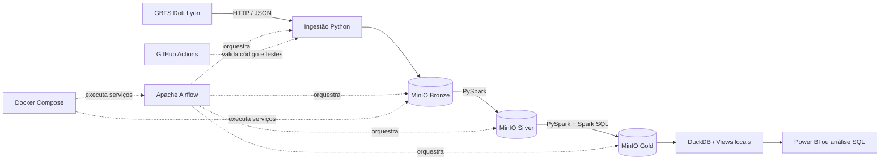
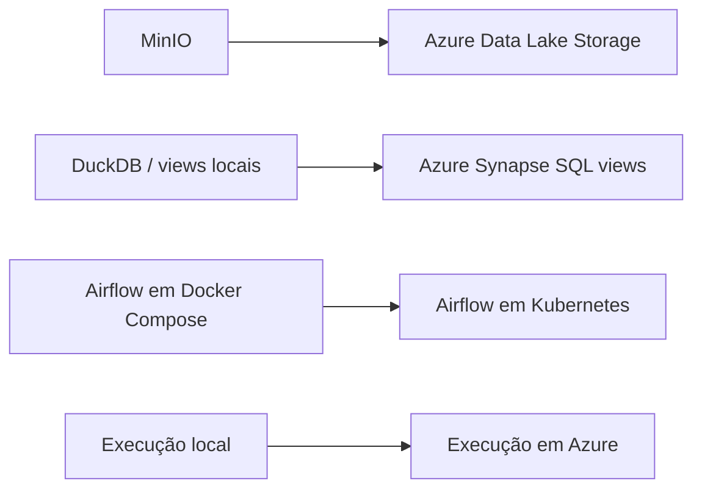

# Dott Lyon Medallion Data Pipeline

> Pipeline de Engenharia de Dados para ingestão, processamento, organização e disponibilização dos dados GBFS de bicicletas e patinetes Dott na Métropole de Lyon, utilizando arquitetura Medalhão e uma stack local, reproduzível e orientada à futura migração para Microsoft Azure.

## Status do projeto


---

## Sumário

- [1. Visão geral](#1-visão-geral)
- [2. Problema e motivação](#2-problema-e-motivação)
- [3. Fonte de dados](#3-fonte-de-dados)
- [4. Objetivos](#4-objetivos)
- [5. De onde o projeto parte e onde pretende chegar](#5-de-onde-o-projeto-parte-e-onde-pretende-chegar)
- [6. Arquitetura proposta](#6-arquitetura-proposta)
- [7. Arquitetura Medalhão](#7-arquitetura-medalhão)
- [8. Stack tecnológica e decisões](#8-stack-tecnológica-e-decisões)
- [9. Estrutura do repositório](#9-estrutura-do-repositório)
- [10. Organização dos dados](#10-organização-dos-dados)
- [11. Fluxo da pipeline](#11-fluxo-da-pipeline)
- [12. Qualidade, observabilidade e reprocessamento](#12-qualidade-observabilidade-e-reprocessamento)
- [13. Segurança e configuração](#13-segurança-e-configuração)
- [14. Estratégia de testes](#14-estratégia-de-testes)
- [15. Execução local planejada](#15-execução-local-planejada)
- [16. Roadmap](#16-roadmap)
- [17. Critérios de sucesso](#17-critérios-de-sucesso)
- [18. Limitações conhecidas](#18-limitações-conhecidas)
- [19. Licença e uso dos dados](#19-licença-e-uso-dos-dados)
- [20. Autor](#20-autor)

---

## 1. Visão geral

Este projeto tem como objetivo construir uma pipeline de dados ponta a ponta usando dados de mobilidade compartilhada da Dott em Lyon. A solução deverá coletar snapshots do feed GBFS, preservar os dados recebidos, tratá-los, aplicar regras de qualidade, produzir conjuntos analíticos e disponibilizar uma camada de consumo por SQL.

A implementação começará integralmente em ambiente local e gratuito. O Data Lake será simulado com MinIO, os serviços serão executados em containers Docker e o Apache Airflow será responsável pela orquestração. Em uma etapa posterior, a arquitetura poderá ser migrada para Azure Data Lake Storage, Azure Synapse Analytics e, opcionalmente, Airflow sobre Kubernetes.

O projeto é intencionalmente orientado à documentação. Decisões arquiteturais, contratos de dados, regras de qualidade, mudanças de schema e procedimentos operacionais serão versionados junto ao código.

---

## 2. Problema e motivação

Feeds de mobilidade em tempo real representam o estado de um sistema em determinado instante. Consultar somente o estado atual não permite responder perguntas históricas, como:

- Como a disponibilidade de veículos varia por horário e dia da semana?
- Quais áreas concentram mais bicicletas ou patinetes disponíveis?
- Em quais momentos há maior indisponibilidade operacional?
- Como a distribuição espacial dos veículos muda ao longo do tempo?
- Há anomalias, quebras de schema ou períodos sem atualização do feed?

A pipeline será construída para transformar snapshots operacionais em dados históricos, governados e consultáveis. O foco não é apenas gerar um dashboard, mas demonstrar fundamentos de Engenharia de Dados: ingestão idempotente, armazenamento em camadas, transformação distribuída, qualidade, rastreabilidade, orquestração, testes e infraestrutura reproduzível.

---

## 3. Fonte de dados

### Dataset escolhido

- **Nome:** Vélos et trottinettes Dott Lyon
- **Publicador:** Dott
- **Cobertura:** Métropole de Lyon, França
- **Formato:** GBFS em JSON
- **Versão informada pelo catálogo:** GBFS 2.3
- **Natureza:** dados em tempo real
- **Catálogo:** https://transport.data.gouv.fr/datasets/tier-dott-gbfs-lyon
- **Feed de descoberta GBFS:** https://gbfs.api.ridedott.com/public/v2/lyon/gbfs.json
- **Termos de uso da API:** https://ridedott.com/api-licence/

O arquivo `gbfs.json` atua como feed de descoberta e fornece referências para os feeds disponibilizados pelo operador. A pipeline deverá descobrir os endpoints em tempo de execução, em vez de manter URLs internas fixas sempre que isso for possível.

### Estratégia de coleta

A fonte já disponibiliza uma API estruturada. Por isso, a primeira versão utilizará requisições HTTP com Python, e não Selenium. Automação de navegador seria mais lenta, mais frágil e desnecessária para esta origem. Um crawler ou Selenium poderá ser avaliado futuramente apenas para uma segunda fonte que realmente dependa de navegação em página.

Cada execução deverá armazenar o payload original e metadados técnicos, possibilitando reconstruir o histórico a partir de snapshots sucessivos.

### Atenção aos termos de uso

Antes da coleta recorrente ou da redistribuição de dados, devem ser revisados os termos vigentes da Dott. O catálogo informa licença não especificada e direciona o usuário aos termos da API. Este repositório não deverá publicar chaves, credenciais nem cópias redistribuíveis dos dados sem autorização.

---

## 4. Objetivos

### Objetivo principal

Desenvolver uma pipeline de dados completa, reproduzível e documentada, que transforme feeds GBFS da Dott Lyon em conjuntos históricos e analíticos organizados nas camadas Bronze, Silver e Gold.

### Objetivos técnicos

- Consumir e validar o feed de descoberta GBFS.
- Coletar snapshots dos feeds disponíveis em intervalos controlados.
- Preservar os payloads originais na camada Bronze.
- Padronizar schemas, tipos, timestamps e identificadores na Silver.
- Criar métricas e tabelas analíticas na Gold.
- Armazenar dados localmente em um Data Lake simulado com MinIO.
- Usar Parquet nas camadas tratadas para leitura analítica eficiente.
- Orquestrar tarefas, dependências, tentativas e agendamentos com Airflow.
- Permitir reprocessamento por data e por identificador de execução.
- Implementar logging, auditoria e testes de qualidade de dados.
- Automatizar verificações de código e testes com GitHub Actions.
- Preparar a arquitetura para migração futura ao ecossistema Azure.

### Fora do escopo inicial

- Rastreamento de usuários ou viagens individuais.
- Previsão de demanda com Machine Learning.
- Streaming de baixa latência.
- Cluster Kubernetes em nuvem.
- Uso do Selenium para esta fonte.
- Dashboard complexo antes da estabilização da pipeline.

---

## 5. De onde o projeto parte e onde pretende chegar

### Ponto de partida

O projeto começa com:

- uma fonte pública/externa em JSON e padrão GBFS;
- ausência de histórico próprio;
- execução local e manual;
- nenhuma infraestrutura criada;
- foco em ferramentas gratuitas;
- documentação da arquitetura antes da implementação.

### Estado intermediário esperado

A versão local deverá possuir:

- MinIO simulando o Data Lake;
- Bronze, Silver e Gold separadas logicamente;
- scripts Python e jobs PySpark independentes;
- dados Silver e Gold em Parquet;
- DAGs no Airflow;
- ambiente Docker Compose reproduzível;
- consultas SQL locais com DuckDB;
- testes automatizados;
- métricas de execução e qualidade;
- documentação de dados e operação.

### Estado final desejado

A arquitetura-alvo deverá permitir:

- substituir MinIO por Azure Data Lake Storage;
- disponibilizar views da Gold no Azure Synapse Analytics;
- conectar Power BI a uma camada SQL estável;
- executar Airflow em Kubernetes quando houver justificativa operacional;
- executar CI/CD pelo GitHub;
- manter rastreabilidade entre fonte, arquivo Bronze, transformação Silver, saída Gold e view de consumo.

O princípio de evolução será: **primeiro uma pipeline correta e observável; depois escala, nuvem e complexidade operacional**.

---

## 6. Arquitetura proposta



### Evolução para Azure



---

## 7. Arquitetura Medalhão

### Bronze: dados brutos e históricos

A Bronze preservará cada resposta recebida com o mínimo de alteração possível.

**Responsabilidades:**

- armazenar o JSON original;
- preservar o conteúdo recebido;
- registrar URL, horário de coleta, status HTTP e identificador da execução;
- permitir auditoria e reprocessamento;
- evitar sobrescrita de snapshots anteriores;
- calcular checksum quando aplicável.

**Não deve fazer:**

- agregações;
- regras de negócio;
- renomeações destrutivas;
- remoção silenciosa de registros;
- correções do conteúdo original.

### Silver: dados limpos e confiáveis

A Silver representará os dados padronizados em nível de entidade.

**Responsabilidades:**

- aplicar schema explícito;
- normalizar nomes de colunas;
- converter epoch para timestamps em UTC;
- registrar horário de ingestão e processamento;
- tratar duplicidades de forma documentada;
- validar campos obrigatórios;
- separar registros inválidos ou rejeitados;
- gravar arquivos Parquet particionados;
- manter granularidade adequada para análises históricas.

### Gold: dados orientados ao negócio e consumo

A Gold conterá produtos de dados derivados da Silver.

**Produtos inicialmente candidatos:**

- disponibilidade de veículos por snapshot;
- disponibilidade por tipo de veículo;
- contagem por hora e dia da semana;
- distribuição por área geográfica, quando os campos permitirem;
- indicadores de atualização e qualidade do feed;
- dimensão de tempo;
- dimensão de veículo ou tipo de veículo, quando aplicável;
- fatos de disponibilidade e status operacional.

As tabelas definitivas serão determinadas após o profiling real dos feeds descobertos.

---

## 8. Stack tecnológica e decisões

### Python

Será a linguagem principal de integração. Ficará responsável por requisições HTTP, descoberta de feeds, validações iniciais, geração de metadados, interação com MinIO, tarefas auxiliares do Airflow e testes.

**Motivo da escolha:** ampla adoção em Engenharia de Dados, boa integração com APIs, Spark e Airflow, além de permitir reaproveitamento do conhecimento entre diferentes partes da pipeline.

### Requests ou cliente HTTP equivalente

Será utilizado para consumir os endpoints GBFS.

**Motivo da escolha:** a origem disponibiliza JSON via HTTP; portanto, uma chamada direta é mais simples e robusta que automação de navegador.

### PySpark

Será utilizado nas transformações Bronze → Silver e Silver → Gold.

**Motivo da escolha:** aproxima o projeto de cenários de processamento distribuído, oferece DataFrames e Spark SQL e permite evoluir o mesmo padrão de transformação para volumes maiores.

### SQL e Spark SQL

Serão utilizados para regras declarativas, validações, agregações e criação da camada de consumo.

**Motivo da escolha:** SQL é essencial para modelagem e exploração de dados e será reutilizável na futura camada de views do Synapse.

### Apache Airflow

Será responsável pela orquestração, e não pela lógica de negócio.

**Uso planejado:**

- agendar coletas;
- controlar dependências;
- executar retries com backoff;
- registrar logs;
- parametrizar intervalos;
- disparar jobs Python e PySpark;
- impedir avanço da pipeline quando validações críticas falharem;
- permitir backfill e reprocessamento.

### MinIO

Simulará localmente um Data Lake baseado em object storage e compatível com a API S3.

**Motivo da escolha:** permite aprender buckets, objetos, prefixos, credenciais e integração com ferramentas de dados sem custos de nuvem. Será o equivalente local conceitual do Azure Data Lake Storage.

### Parquet

Será o formato predominante da Silver e Gold.

**Motivo da escolha:** formato colunar apropriado para análise, compressão e leitura seletiva por engines como Spark e DuckDB.

### DuckDB

Será a camada SQL local para consultar arquivos Parquet e criar views de desenvolvimento.

**Motivo da escolha:** possui baixa complexidade operacional e permite simular a disponibilização SQL da Gold antes de utilizar Synapse.

### Docker e Docker Compose

Executarão MinIO, Airflow, o banco de metadados e os componentes de processamento.

**Motivo da escolha:** tornam o ambiente reproduzível, isolam dependências e reduzem diferenças entre máquinas.

### Git e GitHub

Serão usados para versionamento, revisão, rastreamento de mudanças, documentação, issues e gestão do roadmap.

### GitHub Actions

Executará lint, testes unitários e verificações automáticas em pushes e pull requests.

### Microsoft Azure Data Lake Storage

Será o destino de nuvem futuro das camadas Bronze, Silver e Gold.

**Motivo da escolha:** aproxima o laboratório da arquitetura usada no ambiente profissional de referência. Não é dependência da primeira versão para evitar custos precoces.

### Azure Synapse Analytics

Será usado futuramente para criar views SQL sobre a camada Gold e expor uma interface estável de consumo.

**Motivo da escolha:** permite separar os arquivos físicos do contrato SQL consumido por ferramentas analíticas.

### Kubernetes

Será avaliado depois da estabilização do Airflow em Docker Compose.

**Motivo da escolha:** pode executar e escalar componentes do Airflow, mas introduz complexidade de pods, volumes, rede, secrets e observabilidade. Não deve bloquear a entrega da pipeline local.

### Selenium

Não será utilizado na primeira versão.

**Motivo:** já existe uma API estruturada. Selenium só será introduzido se uma futura origem depender de interação com navegador e não oferecer alternativa apropriada.

---

## 9. Estrutura do repositório

```text
dott-lyon-medallion-pipeline/
├── .github/
│   ├── ISSUE_TEMPLATE/
│   └── workflows/
│       └── ci.yml
├── config/
│   ├── dev.example.yml
│   └── logging.yml
├── dags/
│   └── dott_lyon_medallion_dag.py
├── docs/
│   ├── architecture.md
│   ├── data-contracts.md
│   ├── data-dictionary.md
│   ├── operations.md
│   └── roadmap.md
├── infrastructure/
│   ├── airflow/
│   │   └── Dockerfile
│   ├── docker/
│   │   └── docker-compose.yml
│   ├── kubernetes/
│   │   └── README.md
│   └── minio/
│       └── init-buckets.sh
├── medallion/
│   ├── bronze/
│   │   ├── data/
│   │   │   └── .gitkeep
│   │   ├── jobs/
│   │   │   └── ingest_gbfs.py
│   │   └── README.md
│   ├── silver/
│   │   ├── data/
│   │   │   └── .gitkeep
│   │   ├── jobs/
│   │   │   └── transform_gbfs.py
│   │   └── README.md
│   └── gold/
│       ├── data/
│       │   └── .gitkeep
│       ├── jobs/
│       │   └── build_marts.py
│       ├── sql/
│       │   └── views.sql
│       └── README.md
├── notebooks/
│   └── exploration/
├── src/
│   └── dott_pipeline/
│       ├── clients/
│       ├── common/
│       ├── quality/
│       └── storage/
├── tests/
│   ├── integration/
│   ├── unit/
│   └── data_quality/
├── .env.example
├── .gitignore
├── CHANGELOG.md
├── CONTRIBUTING.md
├── LICENSE
├── Makefile
├── README.md
├── pyproject.toml
└── requirements.txt
```

### Princípios da estrutura

- `medallion/` torna explícitas as responsabilidades de Bronze, Silver e Gold.
- Cada medalhão possui `jobs/`, documentação e uma referência local de `data/`.
- Os dados reais não serão versionados. As pastas `data/` existirão para amostras pequenas autorizadas ou execução local e serão protegidas pelo `.gitignore`.
- Os dados oficiais da pipeline residirão no MinIO ou, futuramente, no Azure Data Lake.
- `src/dott_pipeline/` conterá código reutilizável, evitando duplicação entre jobs.
- `dags/` conterá apenas orquestração e chamadas aos módulos, não transformações extensas.
- `notebooks/` será exclusivo para exploração, nunca a implementação oficial da pipeline.

---

## 10. Organização dos dados

### Organização lógica no Data Lake

```text
datalake/
├── bronze/
│   └── dott_lyon/
│       └── <feed_name>/
│           └── ingestion_date=YYYY-MM-DD/
│               └── run_id=<id>/
│                   ├── payload.json
│                   └── metadata.json
├── silver/
│   └── dott_lyon/
│       └── <entity>/
│           └── event_date=YYYY-MM-DD/
│               └── part-*.parquet
├── gold/
│   └── dott_lyon/
│       └── <data_product>/
│           └── reference_date=YYYY-MM-DD/
│               └── part-*.parquet
└── quarantine/
    └── dott_lyon/
        └── <entity>/
            └── processing_date=YYYY-MM-DD/
```

### Metadados mínimos de ingestão

- `run_id`
- `source_system`
- `source_url`
- `feed_name`
- `requested_at_utc`
- `received_at_utc`
- `http_status`
- `content_type`
- `checksum`
- `payload_size_bytes`
- `record_count`, quando calculável
- `pipeline_version`

### Particionamento

O particionamento será definido com base em medições, não apenas por convenção. A primeira proposta usa data de ingestão na Bronze e data de referência nas camadas tratadas. Partições excessivamente pequenas deverão ser evitadas.

### Versionamento de schema

Schemas esperados devem ser documentados em `docs/data-contracts.md`. Mudanças incompatíveis devem:

1. falhar uma validação controlada;
2. enviar registros à quarentena quando apropriado;
3. gerar log e alerta;
4. ser documentadas antes da adaptação do pipeline.

---

## 11. Fluxo da pipeline

```text
start
  └── discover_feeds
        └── extract_feed_snapshots
              └── validate_http_responses
                    └── write_bronze
                          └── validate_bronze
                                └── bronze_to_silver
                                      └── validate_silver
                                            └── silver_to_gold
                                                  └── validate_gold
                                                        └── refresh_local_views
                                                              └── publish_audit_metrics
                                                                    └── end
```

### Idempotência

Uma nova tentativa da mesma execução não deve duplicar dados. O mecanismo inicial combinará `run_id`, feed, timestamp de referência e checksum. A regra exata será definida por entidade após o profiling.

### Reprocessamento

Os jobs deverão receber parâmetros como:

- data inicial e final;
- `run_id`;
- feed ou entidade;
- camada de origem e destino;
- modo de escrita;
- opção de validação sem persistência.

### Falhas e tentativas

- Erros HTTP transitórios poderão receber retry com espera progressiva.
- Erros de autenticação, licença ou schema não devem ficar em retry infinito.
- Uma falha crítica de qualidade deve impedir a publicação na Gold.
- Dados rejeitados devem ser rastreáveis, não silenciosamente descartados.

---

## 12. Qualidade, observabilidade e reprocessamento

### Métricas operacionais

- duração por tarefa;
- status da execução;
- quantidade de tentativas;
- bytes recebidos e gravados;
- tempo desde a última atualização da fonte;
- quantidade de feeds descobertos;
- erros HTTP por endpoint.

### Métricas de dados

- registros lidos, válidos, rejeitados e gravados;
- percentual de nulos em campos obrigatórios;
- duplicidades por chave candidata;
- timestamps fora de faixa;
- coordenadas inválidas, quando existentes;
- diferença de volume entre camadas;
- atraso entre timestamp da fonte e ingestão.

### Auditoria

Cada saída deverá ser associada ao `run_id`, à versão do código e aos arquivos de origem. A auditoria poderá ser persistida em JSON/Parquet inicialmente e evoluir para uma tabela operacional.

---

## 13. Segurança e configuração

- Credenciais nunca devem ser commitadas.
- `.env` deve permanecer ignorado.
- `.env.example` deve conter apenas nomes e valores fictícios.
- Chaves da API, se exigidas, devem ser tratadas como secrets.
- Logs não devem imprimir tokens ou payloads sensíveis.
- O princípio de menor privilégio será usado no MinIO e no Azure.
- Dados brutos não serão publicados no GitHub sem validação dos termos de uso.

Variáveis inicialmente previstas:

```dotenv
DOTT_GBFS_DISCOVERY_URL=https://gbfs.api.ridedott.com/public/v2/lyon/gbfs.json
MINIO_ENDPOINT=http://localhost:9000
MINIO_ACCESS_KEY=change_me
MINIO_SECRET_KEY=change_me
MINIO_BUCKET=datalake
AIRFLOW_UID=50000
PIPELINE_ENV=dev
```

---

## 14. Estratégia de testes

### Testes unitários

- parsing do feed de descoberta;
- normalização de nomes;
- conversão de timestamps;
- geração de caminhos;
- validações de schema;
- regras de deduplicação;
- cálculo de checksum.

### Testes de integração

- leitura da API e tratamento de respostas;
- escrita e leitura no MinIO;
- leitura Bronze pelo Spark;
- gravação Silver/Gold em Parquet;
- consulta dos arquivos pelo DuckDB;
- execução de uma DAG de teste.

### Testes de qualidade de dados

- campos obrigatórios não nulos;
- unicidade de chaves candidatas;
- integridade entre entidades;
- validade de latitude e longitude;
- coerência temporal;
- atualização do feed dentro do limite esperado.

### Testes de contrato

Uma amostra controlada deverá validar se a estrutura retornada é compatível com o contrato GBFS esperado. Mudanças devem ser detectadas antes de corromper camadas posteriores.

---

## 15. Execução local planejada

> Os comandos abaixo representam a interface pretendida e serão implementados ao longo do projeto.

### Pré-requisitos

- Git
- Docker e Docker Compose
- Python 3.12 para desenvolvimento local
- Java compatível com a versão escolhida do Spark, quando necessário

### Configuração

```bash
git clone <URL_DO_REPOSITORIO>
cd dott-lyon-medallion-pipeline
cp .env.example .env
```

### Subir a infraestrutura

```bash
docker compose -f infrastructure/docker/docker-compose.yml up -d
```

### Executar testes

```bash
make test
```

### Executar lint

```bash
make lint
```

### Executar uma ingestão local

```bash
make ingest
```

### Encerrar os serviços

```bash
docker compose -f infrastructure/docker/docker-compose.yml down
```

---

## 16. Roadmap

### Fase 0: documentação e desenho

- [x] Escolher o dataset.
- [x] Definir arquitetura local-first.
- [x] Definir estrutura inicial do repositório.
- [x] Criar README inicial.
- [ ] Registrar contratos e hipóteses iniciais.
- [ ] Criar backlog em GitHub Issues.

### Fase 1: ingestão Python

- [ ] Descobrir feeds pelo `gbfs.json`.
- [ ] Implementar cliente HTTP com timeout e retries controlados.
- [ ] Armazenar amostras localmente.
- [ ] Adicionar metadados e logs.
- [ ] Criar testes unitários.

### Fase 2: Data Lake local

- [ ] Configurar MinIO com Docker Compose.
- [ ] Criar bucket e prefixos das camadas.
- [ ] Gravar snapshots na Bronze.
- [ ] Implementar convenção de caminhos e `run_id`.

### Fase 3: Silver

- [ ] Fazer profiling dos feeds.
- [ ] Definir schemas explícitos.
- [ ] Criar jobs PySpark.
- [ ] Gravar Parquet particionado.
- [ ] Criar quarentena e regras de qualidade.

### Fase 4: Gold

- [ ] Definir perguntas analíticas.
- [ ] Criar modelo dimensional ou data marts.
- [ ] Implementar agregações Spark SQL.
- [ ] Criar dicionário de dados.

### Fase 5: Airflow

- [ ] Criar DAG ponta a ponta.
- [ ] Adicionar retries, parâmetros, backfill e logs.
- [ ] Registrar métricas de auditoria.
- [ ] Testar falhas e reprocessamento.

### Fase 6: consumo local e CI

- [ ] Criar views no DuckDB.
- [ ] Conectar Power BI ou cliente SQL.
- [ ] Configurar GitHub Actions.
- [ ] Automatizar lint e testes.

### Fase 7: Azure

- [ ] Migrar amostra para Azure Data Lake Storage.
- [ ] Criar views no Azure Synapse Analytics.
- [ ] Validar acesso pela ferramenta de BI.
- [ ] Documentar custos e diferenças da versão local.

### Fase 8: Kubernetes

- [ ] Criar laboratório local com Kind ou Minikube.
- [ ] Implantar componentes do Airflow.
- [ ] Avaliar executor e escalabilidade.
- [ ] Documentar quando Kubernetes é ou não justificável.

---

## 17. Critérios de sucesso

O projeto será considerado funcional quando:

- uma execução puder descobrir e coletar os feeds configurados;
- o payload original for preservado na Bronze;
- Silver e Gold puderem ser reconstruídas a partir da Bronze;
- execuções repetidas não criarem duplicações indevidas;
- falhas críticas interromperem a publicação;
- métricas de volume e qualidade forem registradas;
- arquivos Gold puderem ser consultados por SQL;
- o ambiente puder ser reproduzido com instruções documentadas;
- testes automatizados passarem no GitHub Actions;
- nenhuma credencial ou dado proibido estiver versionado.

---

## 18. Limitações conhecidas

- O feed representa snapshots e não necessariamente viagens concluídas.
- A disponibilidade da origem está fora do controle do projeto.
- Endpoints e schemas podem mudar.
- Coletas locais dependem de o computador estar ligado até que haja um ambiente persistente.
- A granularidade histórica dependerá da frequência de coleta adotada e dos termos de uso.
- A arquitetura usa Spark para fins de aprendizado mesmo que o volume inicial possa ser processado por ferramentas menores.
- Kubernetes será uma evolução, não um requisito da primeira entrega.

---

## 19. Licença e uso dos dados

O código deste repositório poderá ser licenciado separadamente dos dados. A presença de uma licença de software não concede direitos sobre os dados da Dott.

Antes de coletar, armazenar, publicar ou redistribuir os dados:

1. consulte a página oficial do dataset;
2. consulte os termos vigentes da API da Dott;
3. confirme se chave ou autorização é necessária;
4. não publique credenciais;
5. não versione dados brutos sem permissão;
6. revise limites de uso, retenção e redistribuição.

Até a definição final, o arquivo `LICENSE` deste scaffold contém um aviso de licença pendente, e não uma autorização de uso ampla.

---

## 20. Autor

**Gustavo Balbino Dos Santos**

Projeto desenvolvido para estudo e portfólio em Engenharia de Dados, com foco em pipelines, arquitetura Medalhão, processamento distribuído, orquestração e evolução para Microsoft Azure.
